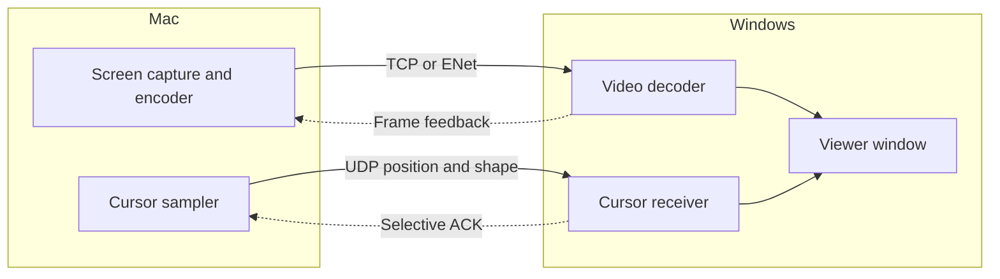

# MaxDisplay

[](https://github.com/kagamir/maxdisplay/actions/workflows/build.yml)
[](https://github.com/kagamir/maxdisplay/releases/latest)

**Use a Windows PC as a second display for your Mac.**

MaxDisplay adds a virtual display named **MaxDisplay** to your Mac and streams it to a Windows PC, which shows it full screen. Keep your code on the Mac's built-in screen and drag a browser, or any other window, onto the Windows one. The Mac handles keyboard and pointer input.

[Quick start](#quick-start) · [Configuration](#configuration) · [Command reference](#command-reference) · [Troubleshooting](#troubleshooting) · [Building from source](#building-from-source) · [How it works](#how-it-works)

## Features

- **A real extended display.** macOS treats MaxDisplay like any other monitor, so you arrange it in System Settings and drag windows across.
- **Fits the Windows screen automatically.** The stream matches the pixel resolution of the monitor the receiver is on. `--size` and `--scale` give you HiDPI rendering or more desktop room.
- **H.264, H.265 and AV1.** The Mac encodes with VideoToolbox hardware, Windows decodes with hardware when it can, and software fallbacks are built in on both sides.
- **Adapts to your network.** Bitrate and frame rate adjust on their own, up to 60 fps and 12 Mbps by default.
- **Local Mac pointer on Windows.** The viewer draws the Mac pointer over the last picture as soon as its position arrives, even while a video frame is in transit.
- **Sharp when still.** Once the desktop stops changing, the Mac keeps refining the last picture so text and edges clear up.
- **TCP or UDP.** TCP is the default. UDP keeps latency low on networks that drop packets.
- **Recovers by itself.** After loss or a timeout the receiver holds the last picture and resumes at the next keyframe. After a disconnect it waits for the Mac to come back.
- **One executable per platform.** There is no installer and no background service.

## Requirements

| | Mac (sender) | Windows (receiver) |
| --- | --- | --- |
| System | macOS 13 or later | Windows 10 version 1703 or later, or Windows 11, x64 |
| Prebuilt download | Apple Silicon | x64 |
| Setup | Screen Recording permission | Windows N editions need the Media Feature Pack, followed by a restart |

Use the same MaxDisplay version on both computers. The Mac must be able to reach the Windows receiver over the selected transport. By default, MaxDisplay sends video and feedback in plaintext. Use this default on a trusted private network, or enable password encryption on both computers.

## Quick start

### 1. Download

Get both files from the same [GitHub release](https://github.com/kagamir/maxdisplay/releases/latest), under **Assets**. In the filenames below, `<tag>` is the release tag.

| Platform | File |
| --- | --- |
| Windows x64 | `maxdisplay-<tag>-windows-x64.exe` |
| Mac with Apple Silicon | `maxdisplay-<tag>-macos-arm64.tar.gz` |

On the Mac, double-click the archive to extract `maxdisplay-<tag>`. Rename the extracted file to `maxdisplay` for the Terminal commands below. You can check its tag after renaming it.

```bash
./maxdisplay --version
```

### 2. Start the receiver on Windows

Double-click the downloaded `.exe` to start the receiver. To use the PowerShell commands in this guide, rename the file to `maxdisplay.exe` and run it from its folder.

```powershell
.\maxdisplay.exe receive
```

If Windows Firewall asks about network access, allow inbound TCP and UDP on the receiver port on private networks.

The waiting screen shows the release tag, the addresses the receiver is listening on and the pixel resolution of its monitor. Compare the tag with the Mac's `--version` output. Addresses on the adapter with the default route come first. The examples below use `192.168.1.50`.

### 3. Start the sender on the Mac

Replace the address with one from the Windows waiting screen:

```bash
./maxdisplay send 192.168.1.50
```

The first run needs Screen Recording permission. If macOS asks you to restart the app:

1. Open **System Settings → Privacy & Security → Screen Recording**. Some macOS versions call it **Screen & System Audio Recording**.
2. Allow the terminal or app named in the prompt.
3. Quit that app completely, reopen it, and run the command again.

### 4. Arrange the display

On the Mac, open **System Settings → Displays → Arrange** and drag **MaxDisplay** to the side where the Windows PC actually sits. Then drag a window across that edge.

### Controls

| Where | Key | Action |
| --- | --- | --- |
| Windows | **F11** | Toggle full screen |
| Windows | **Esc** | Exit the receiver |
| Mac | **Ctrl+C** | Stop sharing and remove the virtual display. The receiver keeps waiting for the next connection |

### Defaults

| Setting | Default |
| --- | --- |
| Codec | H.264 |
| Video transport | TCP. Windows listens on TCP and UDP at port 49300 |
| Encryption | Off |
| Stream resolution | The pixel resolution of the monitor the receiver window is on |
| Frame rate | Up to 60 fps |
| Bitrate | Up to 12 Mbps |
| Frame timeout | 200 ms |

The receiver listens on all IPv4 interfaces and accepts one Mac at a time. While it is waiting or playing, it stops Windows from turning off the display or going to sleep when idle, and it releases that request on exit. When the Mac's screen is still, the last frame stays on screen.

## Configuration

Both executables print their options with `--help`. This example moves the receiver to a specific address and port in a window, and sends a 2560×1440 desktop at up to 24 Mbps:

```powershell
.\maxdisplay.exe receive --bind 192.168.1.50 --port 49301 --windowed
```

```bash
./maxdisplay send 192.168.1.50 --port 49301 --size 2560x1440 --fps 60 --bitrate-mbps 24
```

### Resolution and scaling

Two options on the Mac control the picture size:

- **`--size`** sets the logical resolution of the Mac's virtual desktop, which decides how much fits on it.
- **`--scale`** sets how many stream pixels each logical point gets. The default is 1.

The stream size is `--size` multiplied by `--scale`. A scale above 1 gives sharper, larger content. A scale below 1 gives more room.

Without `--size`, the Mac asks the receiver at connection time for the current pixel resolution of the monitor the receiver window is on, divides the width and height by `--scale`, and rounds the result to get the logical size. The Windows display scaling percentage plays no part.

| Windows screen | Mac options | Mac virtual desktop | Stream |
| --- | --- | --- | --- |
| 1920×1080 | none | 1920×1080 | 1920×1080 |
| 1920×1080 | `--scale 0.75` | 2560×1440 | 1920×1080 |
| 2560×1440 | `--scale 2` | 1280×720 | 2560×1440 |
| 1920×1080 | `--size 1280x720 --scale 1.5` | 1280×720 | 1920×1080 |

Details worth knowing:

- With an explicit `--size`, the logical size stays exactly as given. The width and height multiplied by `--scale` must both be even integers.
- In automatic mode, if one side of the Windows screen has an odd number of pixels, the stream is 1 pixel smaller on that side, as 4:2:0 video requires.
- A scale above 1 asks macOS to draw the virtual desktop at 2× HiDPI and then resamples it to the stream size. If macOS cannot enable HiDPI, the logical desktop size stays the same.
- The Mac's startup log prints the virtual desktop size and the stream size separately.

**Limits.** The stream can be at most 4096×2304. H.264 is also bound by the Level 5.1 macroblock rate, so the automatic frame rate caps 3840×2160 at 30 fps. If the Windows screen is larger than the supported range, pass a smaller `--size` and `--scale` explicitly.

### Codecs and hardware acceleration

Choose the codec on the Mac with `--codec h264`, `--codec h265` or `--codec av1`. The receiver detects it automatically.

| Codec | Mac encoder | Windows decoder |
| --- | --- | --- |
| H.264 (default) | VideoToolbox hardware, then the system software encoder | Hardware when available, then software |
| H.265 | VideoToolbox hardware, then the system software encoder | Hardware when available, then software |
| AV1 | Built-in libaom software encoder | Hardware when available, then software |

- On the Mac, if hardware setup, encoding or a bitrate change fails, MaxDisplay logs the reason and switches to the system's software encoder for the same codec.
- On Windows, if hardware decoding fails, MaxDisplay prints a warning and switches to software. The fallbacks are Windows Media Foundation and the built-in HEVC and AV1 software decoders, so H.265 works even without the system HEVC component.
- Pass `--require-hardware` on either side to make that side use hardware only. On the Mac it applies to H.264 and H.265.

### TCP or UDP

TCP is the default. It delivers everything in order, so data already written to the connection still has to arrive, even when it is late.

UDP splits each picture into fragments. Missing keyframe fragments are retransmitted individually, and a regular frame that loses a fragment is skipped. Choose UDP when low latency matters more than every frame on a network that drops packets, such as Wi-Fi.

Select `--transport udp` on the Mac. The same Windows receiver accepts TCP or UDP video on its configured port, one stream at a time. For example, this sends a 2560×1440 H.265 stream at up to 60 fps over Wi-Fi:

```powershell
.\maxdisplay.exe receive
```

```bash
./maxdisplay send 192.168.1.50 --codec h265 --transport udp --size 1280x720 --scale 2 --fps 60 --bitrate-mbps 16 --frame-timeout-ms 150
```

### Mac pointer on Windows

From startup, Windows hides its own pointer over the viewer's display area, including the waiting screen. In windowed mode, the title bar and resize borders keep their normal Windows cursors.

The Mac shares pointer coordinates and shapes only while the hotspot is on the MaxDisplay virtual screen. Crossing onto the built-in screen or another display hides the pointer on Windows. While the hotspot stays outside, heartbeats and retries carry zero coordinates and no shape.

The Mac samples its pointer every 4 ms. With either video transport, the Mac sends pointer positions and shapes directly to the video receiver’s UDP port. Windows handles those packets independently of video decoding. Windows draws the pointer over the video without moving the local Windows mouse. On a still desktop, moving the Mac pointer alone lets the video encoder stay idle after static refinement finishes.

Windows replies from the listening port when it receives a valid cursor packet from the Mac. The Mac keeps the pointer in video if it receives no cursor acknowledgement within one second of startup. During streaming it returns to video after two seconds without an acknowledgement. After acknowledgements resume for one second, Windows waits for a cursor-free video frame before showing the overlay again. To keep the pointer in the video throughout a session, add `--video-cursor` to the Mac command. This also skips the cursor handshake.

If the sender reports a cursor timeout, allow inbound UDP on the Windows receiver port (49300 by default). A TCP-only firewall rule can carry TCP video while the pointer falls back to the video.

Pointer shapes are rasterized at the stream scale, up to 256×256 pixels. When macOS cannot supply the current shape, the viewer may show the standard arrow. Pointers drawn by an application into its own window remain part of the captured picture.

### Password encryption

Start the Windows receiver and the Mac sender with the same nonempty password. Replace the example value with a long, randomly generated password. These commands use TCP. Add `--transport udp` on the Mac for UDP video.

```powershell
.\maxdisplay.exe receive --password 'your-shared-password'
```

```bash
./maxdisplay send 192.168.1.50 --password 'your-shared-password'
```

Both peers contribute fresh random values on each connection. PBKDF2-HMAC-SHA256 runs for 600,000 iterations at connection setup. The peers prove they have the same password before exchanging cursor connection details, display dimensions, stream settings, video or feedback. AES-128-GCM encrypts and authenticates these messages with separate keys for each direction. The UDP cursor channel uses its own directional keys and accepts authenticated, reordered packets within a 64-packet replay window.

Omit `--password` on **both** computers to use plaintext. A password mismatch or a peer configured for a different mode ends the connection. A password passed on the command line can appear in shell history and process listings.

### Adaptive bitrate and frame rate

Both adapt by default. `--bitrate-mbps` and `--fps` set the ceilings.

- When the network starts to queue, MaxDisplay lowers the bitrate first.
- It lowers the frame rate only when encoding stays too slow, or when a backlog remains after repeated bitrate cuts. The frame rate moves in whole divisors of the capture ceiling, such as 60, 30, 20 and 15 fps.
- Healthy feedback adds up across the idle gaps in normal desktop use, and recovery returns to the last stable bitrate first.
- `--fixed-bitrate` holds the bitrate target while the frame rate still adapts. `--fixed-fps` holds the frame rate target while the bitrate still adapts. You can combine them.

The console reports each change to the targets.

### Refinement when the screen is still

When the desktop stops changing, the Mac re-encodes the last picture for up to 2 seconds so text and edges get progressively cleaner. It stops early when:

- a VideoToolbox encoder that reports quality metrics reaches a luma PSNR of 42 dB, or improves by less than 0.2 dB over 500 ms,
- the AV1 quantizer drops to 24 or below, or
- a frame is dropped or the network becomes congested.

### Frame timeout and recovery

`--frame-timeout-ms` sets the real-time budget for a frame. The default is 200 ms.

- The sender drops frames that have waited in its queue too long.
- The receiver estimates added queueing delay from the change in timing between frames, so the two clocks do not need to be synchronized.
- After a sequence gap, a timeout or a decoding error, the receiver keeps the last displayed picture, waits for a keyframe it can decode on its own, and then resumes.
- Keyframes are requested only at stream start and during recovery, and they get a wider time limit for sending and acknowledgement. Over UDP, at most one keyframe awaits acknowledgement at a time.

This budget does not guarantee the total delay from capture to the screen lighting up.

### Statistics

Add `--stats` on either side to print per-second statistics on that device. Use it on both when you are chasing blur or stutter.

- **Mac:** target and actual bitrate and frame rate, round-trip time, estimated queueing delay, encoding time, available quality metrics, counts of step-downs and keyframes by cause, and cursor RTT, datagrams sent, retransmissions and shape transfers.
- **Windows:** frames received, decoded and actually drawn, with their timings, the decoder type, reasons for keyframe requests, and cursor updates, sequence gaps and repaints.

## Command reference

### `maxdisplay send <windows-host>` on macOS

| Option | Default | Description |
| --- | --- | --- |
| `--port PORT` | `49300` | Receiver port |
| `--size WIDTHxHEIGHT` | Windows monitor ÷ scale | Logical size of the virtual desktop |
| `--scale FACTOR` | `1` | Stream pixels per logical point. Any positive number, such as `1.5` or `2` |
| `--codec NAME` | `h264` | `h264`, `h265` (or `hevc`) or `av1` |
| `--transport NAME` | `tcp` | Video transport (`tcp` or `udp`) |
| `--fps FPS` | `60` | Frame rate ceiling, 1 to 120 |
| `--bitrate-mbps MBPS` | `12` | Bitrate ceiling, 1 to 100 |
| `--frame-timeout-ms MS` | `200` | Real-time frame budget, 1 to 60000 |
| `--fixed-bitrate` | off | Hold the bitrate at its target |
| `--fixed-fps` | off | Hold the frame rate at its target |
| `--video-cursor` | off | Capture the Mac pointer in the video and skip the separate cursor connection |
| `--require-hardware` | off | Use the hardware encoder only. H.264 and H.265 |
| `--stats` | off | Print per-second statistics |

### `maxdisplay [receive]` on Windows

| Option | Default | Description |
| --- | --- | --- |
| `--bind IP` | `0.0.0.0` | Local address to listen on. IPv4 supports both video transports. An IPv6 address supports TCP video and the UDP pointer |
| `--port PORT` | `49300` | Shared TCP and UDP listening port |
| `--windowed` | off | Start in a window instead of full screen |
| `--require-hardware` | off | Use a hardware decoder only |
| `--stats` | off | Print per-second statistics |

### Both platforms

| Option | Description |
| --- | --- |
| `--password VALUE` | Enable AES-128-GCM with a shared password. Omit on both peers for plaintext |
| `--help`, `-h` | Show usage |
| `--version` | Print `MaxDisplay <tag>` for a tagged build or `MaxDisplay dev` for an untagged build, then exit |
| `--licenses` | Print the notices for bundled third-party software |

## Troubleshooting

**The Mac cannot connect.**
Start the Windows receiver first. Use an address from its waiting screen, and use the same `--port` on both sides. In Windows Firewall, allow inbound TCP and UDP for that port on private networks (49300 by default).

**The sender stops and asks for Screen Recording.**
Allow the terminal or app under **System Settings → Privacy & Security → Screen Recording**, quit it completely, reopen it, and run the command again.

**The picture is soft or it stutters.**
Add `--stats` on both sides to see where frames are lost or delayed. Raise `--bitrate-mbps` if the network has room. On Wi-Fi or any network that drops packets, try `--transport udp` on the Mac.

**The sender rejects the size.**
The stream cannot exceed 4096×2304, and with an explicit `--size` the width and height multiplied by `--scale` must be even integers. Pass a smaller or different `--size` and `--scale`.

**3840×2160 runs at 30 fps.**
That is the H.264 Level 5.1 limit at that size.

## Building from source

You need CMake 3.20 or later and Git. The first configure step downloads pinned versions of ENet, Mbed TLS, libaom and, on Windows, libde265, and links them statically. Run the commands from the repository root.

### macOS 13 or later

Install Xcode, or the Command Line Tools with a macOS SDK.

```bash
cmake -S . -B build -DCMAKE_BUILD_TYPE=Release
cmake --build build --parallel
./build/maxdisplay --help
```

### Windows 10 (1703 or later) or Windows 11, x64

Install Visual Studio 2022 with the **Desktop development with C++** workload and a Windows SDK, and put NASM on your `PATH`.

```powershell
cmake -S . -B build -G "Visual Studio 17 2022" -A x64
cmake --build build --config Release --parallel
.\build\Release\maxdisplay.exe --help
```

### Tests

```bash
ctest --test-dir build -C Release --output-on-failure
```

The tests cover the protocol, option parsing, rate adaptation and keyframe recovery. On macOS they also start a virtual display and capture from it, which needs Screen Recording permission. CI additionally encodes test patterns on the Mac and checks decoded pixels, frame order and TCP and UDP reception on Windows. The Windows HEVC tests include the software fallback used when the system HEVC component is missing.

To check a real pair of machines by hand:

1. Drag a window onto the virtual display and move the pointer across it.
2. Confirm that the Windows screen shows only the extended area.
3. Stop the sender and check that MaxDisplay is gone from the Mac's display list.
4. Connect again to confirm the receiver can be reused.

### Releases

Pushing a Git tag makes CI build both platforms, run the cross-platform interoperability tests and, once they pass, publish the binaries to the GitHub Release of the same name.

Filenames preserve letters A–Z and a–z, digits, periods, underscores and hyphens. Each other UTF-8 byte is written as an underscore and two hex digits. For example, the tag `release/v1.2.3` appears as `release_2Fv1.2.3` in filenames and as `release/v1.2.3` in `--version` and on the Windows waiting screen.

To embed a tag in a local build, pass `-DMAXDISPLAY_RELEASE_TAG=<tag>` when configuring CMake. For example, `-DMAXDISPLAY_RELEASE_TAG=v1.2.3-rc.1` makes `--version` print `MaxDisplay v1.2.3-rc.1`.

## How it works



MaxDisplay is one C++17 codebase and one CMake project that builds a single executable for each operating system. macOS system APIs are called through Objective-C++.

- **Virtual display and capture.** macOS creates the display through CoreGraphics' private `CGVirtualDisplay` interface and captures its image with ScreenCaptureKit. In local-pointer mode ScreenCaptureKit omits the system pointer.
- **Encoding.** VideoToolbox runs in real-time mode with frame reordering off. H.264 keyframes carry SPS and PPS, and HEVC Main keyframes carry VPS, SPS and PPS, all sent as Annex B. AV1 uses libaom in a low-latency configuration.
- **Protocol.** The v3 handshake negotiates codec, picture size, frame rate and timeout. Every access unit carries a sequence number, a sender timestamp and a flag marking real keyframes. The receiver reports its progress and requests keyframes.
- **Pointer.** The receiver provides a session token before the v3 video header. For IPv4, one Windows UDP socket handles both ENet video and cursor datagrams. Absolute positions are measured in eighths of a video pixel. A later position supersedes earlier ones. The sender repeats the final position until acknowledged, and uses selective acknowledgements to fill missing shape fragments. Windows caches the 64 most recent shapes and repaints only the areas affected by cursor motion. During a handoff, the cursor state can also specify the first video frame without a baked-in pointer.
- **Transport.** TCP prefixes each frame with a big-endian length. UDP uses ENet: the handshake and keyframes travel reliably, and all other frames go as droppable, sequenced messages.
- **Display.** Windows builds the picture from the decoded YUV data, scales it proportionally and adds black bars when needed. The D3D11 path reads the actual decoded surface.

## Third-party software

MaxDisplay links these libraries statically. Run `maxdisplay --licenses` for the full notices.

| Library | Used for | License |
| --- | --- | --- |
| [ENet](http://enet.bespin.org/) | UDP transport | MIT |
| [Mbed TLS](https://github.com/Mbed-TLS/mbedtls) | Password-based key derivation and AES-128-GCM | Apache-2.0 or GPL-2.0-or-later |
| [libaom](https://aomedia.googlesource.com/aom/) | AV1 encoding and decoding | BSD 2-Clause, with the AOM Patent License 1.0 |
| [libde265](https://github.com/strukturag/libde265) | HEVC software decoding on Windows | LGPL-3.0-or-later |

To replace the bundled HEVC decoder library and relink the Windows program, download `maxdisplay-<tag>-windows-relink.zip` from the same release.
